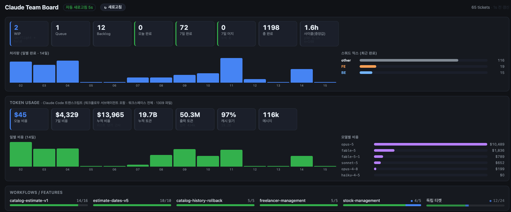
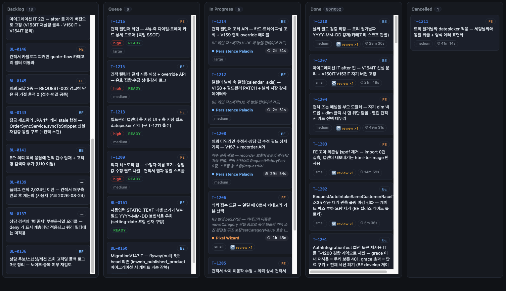
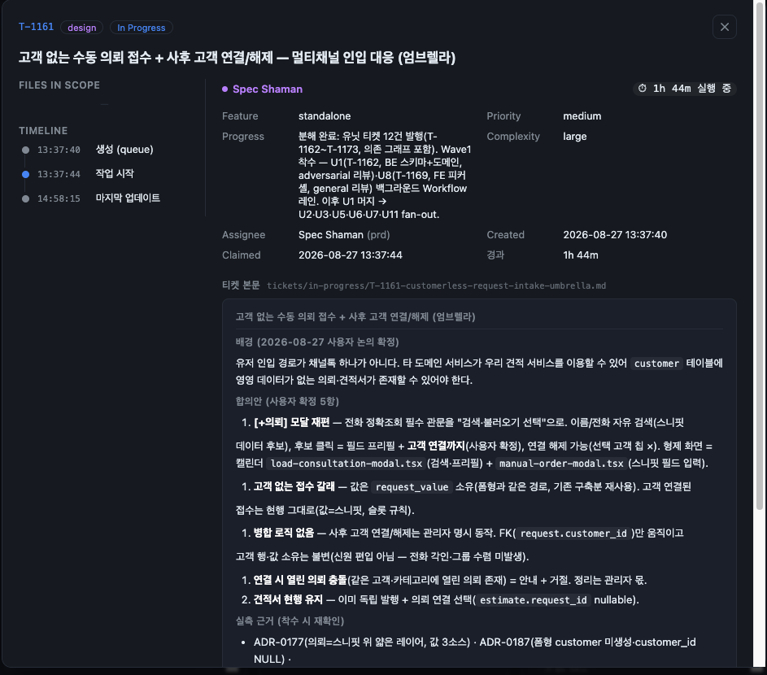

# Claude Team Board

**멀티 에이전트 AI 개발 워크플로우 실시간 관제 대시보드**

[personal-claude-code v2](https://github.com/sideholic/personal-claude-code-v2) 플러그인이 병렬로 돌리는 Claude Code 에이전트들의 **진행 상황 · 병목 · 처리량 · 토큰 비용**을 한 화면에 표시. 플러그인 산출물(`.claude-team/`)과 Claude Code 트랜스크립트를 **읽기만** 하는 read-only 뷰.



---

## 배경

- 오케스트레이터(Technoking)가 요청을 티켓으로 분해 → 페르소나 에이전트(Spec Shaman · Galaxy Brain · Persistence Paladin · Pixel Wizard · What-If Witch · Roastmaster)가 각자 worktree에서 병렬 처리
- 에이전트 5~6개 동시 실행 시 tmux 로그만으로는 **누가 · 무엇을 · 얼마나 오래 · 얼마를 쓰며** 작업 중인지 파악 불가
- 오케스트레이션 상태를 한눈에 읽는 관제탑 필요 → 본 프로젝트 제작

---

## 기능

| 패널 | 내용 |
|---|---|
| **운영 메트릭** | WIP · Queue · Backlog · 오늘/7일/누적 완료 · 7일 머지 · 사이클 타임(중앙값 · p90) · 14일 처리량 차트 · BE/FE 스쿼드 믹스 |
| **토큰 사용량** | 오늘/7일/누적 비용 · 누적 토큰 · 캐시 적중률 · 일별 비용 차트 · 모델별 비용 순위. 서브에이전트 트랜스크립트 포함 |
| **워크플로우 롤업** | `parent_feature` 단위 진행률(`14/16`) · 진행 중 피처 표시 |
| **칸반 보드** | Backlog → Queue → In Progress → Done → Cancelled. 티켓 폴더 = 상태, 5초 폴링 |
| **티켓 상세** | 타임라인(초 단위) · 담당 에이전트 · 우선순위 · 복잡도 · 의존 티켓 · 마크다운 본문 |
| **이벤트 피드** | `events.jsonl` SSE tail, 최신순 |

**칸반 카드 세부**

- 진행 중 카드: 담당 페르소나 + **실행 시간 1초 단위 라이브** + 진행 메모 + 리뷰/레스큐 횟수
- **정체 감지**: 마지막 활동이 기준(기본 2h) 초과 시 ⚠ 강조
- **Queue 정렬**: 우선순위 → 의존성 충족(`READY`) 순
- 누적 컬럼은 최근 N건만 렌더링, 총량 병기(`50/1052`)





---

## 빠른 시작

요구 사항: Node.js 22+, pnpm, 플러그인이 생성한 `.claude-team/` 디렉터리(읽기 권한)

```bash
pnpm install
EVENTS_LOG=/absolute/path/to/project/.claude-team/events.jsonl pnpm dev
# → http://localhost:7777
```

Docker:

```bash
docker build -t claude-board .
docker run -p 7777:7777 \
  -v /absolute/path/to/project/.claude-team:/data/.claude-team:ro \
  claude-board
```

> `.claude-team` 디렉터리 전체를 `:ro`로 마운트. 토큰 패널은 호스트의 `~/.claude/projects`를 읽으므로 컨테이너에서는 비어 있을 수 있음.

테스트: `pnpm test` (Vitest)

### 환경변수

| 변수 | 설명 | 기본값 |
|---|---|---|
| `EVENTS_LOG` | `.claude-team/events.jsonl` 절대 경로. 상위 폴더가 보드 루트 | `../personal-claude-code-v2/.claude-team/events.jsonl` |
| `PORT` | 서버 포트 | `7777` |
| `STALE_HOURS` | 정체 판정 무활동 시간 | `2` |

---

## 설계 포인트

- **Read-only 불변식** — 플러그인 상태를 쓰지 않고 오케스트레이터를 깨우지 않음. 관측이 간섭이 되는 문제(v1 wake-channel) 차단
- **디렉터리 = 상태 + 이벤트 로그 하이브리드** — 소스 오브 트루스는 `tickets/<status>/` 폴더. 이벤트 로그는 초 단위 타임스탬프 보강용. 중복 마일스톤 병합 처리
- **스키마 드리프트 허용** — 상태 디렉터리 변경(`in-progress` → `in-flight`, `hold`, 형제 `backlog/`)을 컬럼 매핑으로 흡수. 미지 이벤트 타입은 무시
- **바운디드 I/O** — 프런트매터만 필요하므로 파일 앞 4KB만 읽기. 누적 컬럼은 최근 N건만 파싱. 보드 5s · 메트릭 15s · 토큰 60s로 폴링 주기 분리
- **트랜스크립트 파싱 캐시** — 수 GB 트랜스크립트를 `(size, mtime)` 키로 파일 단위 캐시. 첫 요청 이후 변경 파일만 재파싱
- **SSE tail** — 파일 오프셋 기반 증분 읽기. truncation/rotation 시 오프셋 리셋, 15초 ping으로 연결 유지

---

## 아키텍처

```
.claude-team/{tickets,backlog,events.jsonl}     ~/.claude/projects/**/*.jsonl
            │ read · tail                                 │ read (cached)
            ▼                                             ▼
┌──────────────────────────────────────────────────────────────────┐
│ Next.js Route Handlers (Node runtime, read-only)                 │
│ /api/board  /api/metrics  /api/tokens  /api/ticket  /api/events  │
└──────────────────────────────────────────────────────────────────┘
            │ 5s        │ 15s       │ 60s       │ SSE
            ▼           ▼           ▼           ▼
       app/page.tsx — 메트릭 · 토큰 · 롤업 · 칸반 · 피드 (단일 클라이언트 컴포넌트)
```

---

## 기술 스택

- Next.js 16 (App Router) · React 19 · TypeScript · Vitest · Docker multi-stage
- 외부 UI/차트/상태관리 라이브러리 없음. 차트는 CSS, 마크다운 렌더러 자체 구현
- 서버 컴포넌트 기본, 보드 페이지만 클라이언트 컴포넌트

## 프로젝트 구조

```
app/page.tsx          보드 · 패널 · 상세 모달
app/api/board         폴더 스캔 → 카드 · 롤업 (+ test)
app/api/metrics       KPI · 처리량 · 사이클 타임
app/api/tokens        트랜스크립트 토큰/비용 집계
app/api/ticket        티켓 본문
app/api/events        SSE tail
lib/events.ts         이벤트 계약 타입 · 페르소나 매핑 · reduce (+ test)
lib/frontmatter.ts    프런트매터 파서 (+ test)
lib/markdown.tsx      마크다운 렌더러
```

## 관련 프로젝트

- [personal-claude-code v2](https://github.com/sideholic/personal-claude-code-v2) — 관측 대상 오케스트레이션 플러그인. 티켓 스키마 · 이벤트 계약 원본
